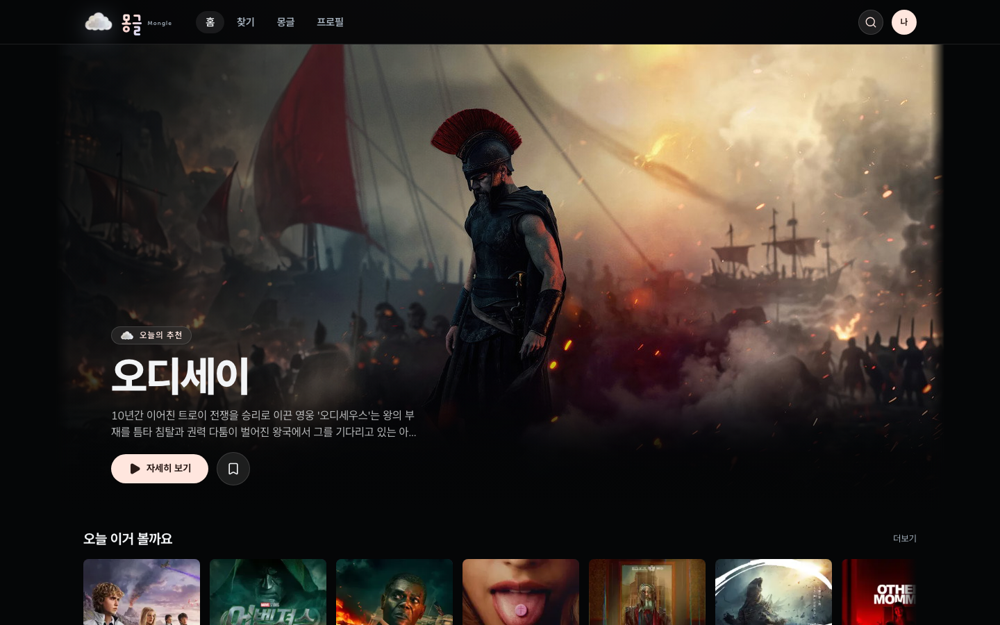
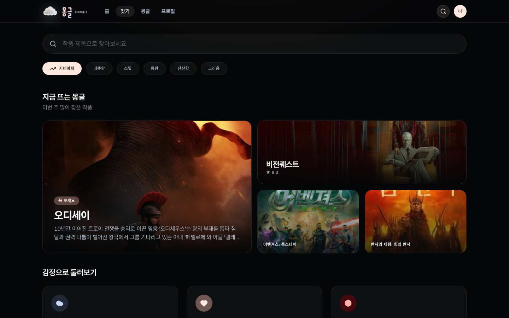
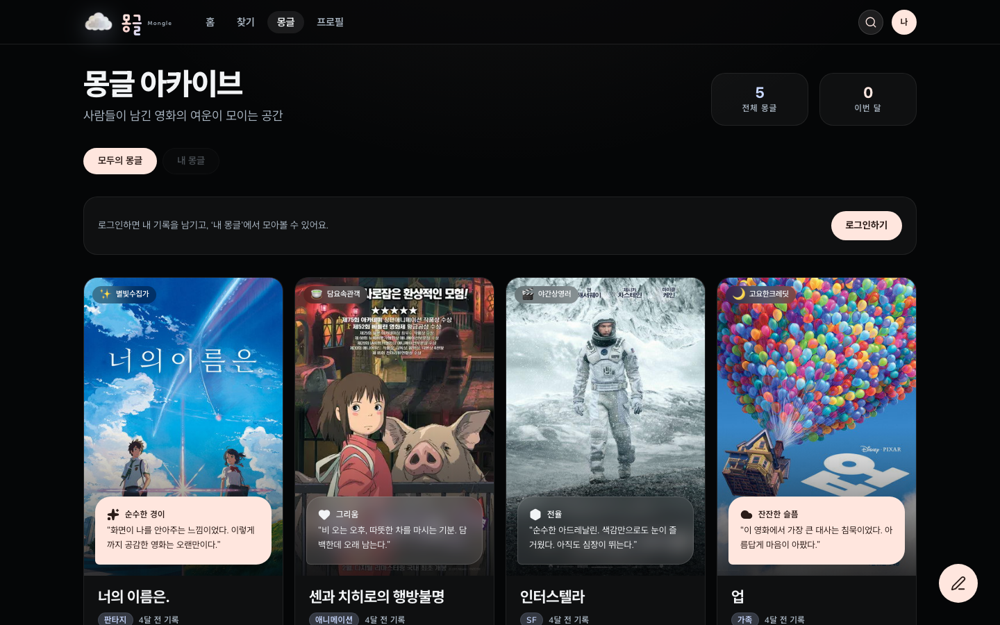
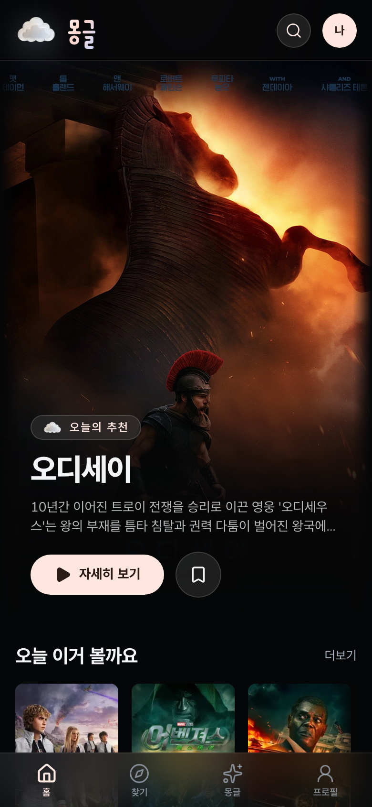

# 몽글 (Mongle)

영화와 감정을 부드럽게 기록하는 시네마틱 웹 앱입니다.  
부드러운 진주(pearl) 글래스 UI 위에, 오늘의 추천 · 작품 찾기 · 몽글 아카이브를 담았습니다.

**Live:** [mongle-steel.vercel.app](https://mongle-steel.vercel.app)  
**Repository:** [github.com/august5pm/mongle](https://github.com/august5pm/mongle)

---

## 미리보기

| 홈 | 찾기 |
|:--:|:--:|
|  |  |

| 아카이브 | 모바일 홈 |
|:--:|:--:|
|  |  |

---

## 주요 기능

- **홈** — 히어로 · 일/주 트렌딩 · 날짜 로테이션 큐레이션 (스와이프 레일)  
- **찾기** — 작품 검색, 감정 칩, 트렌딩 벤토  
- **몽글** — Google 로그인 후 감정 한 줄 기록 · 수정·삭제 · 공개 아카이브 · **좋아요**  
- **위시리스트** — 작품 찜 (계정 연동)  
- **프로필** — 닉네임·이모지 아바타

---

## 스택

| 구분 | 선택 |
|------|------|
| Framework | Next.js 14 (App Router) + TypeScript |
| Styling | Tailwind CSS + `globals.css` 유틸 |
| Auth / DB | Supabase (Google OAuth + `journals` / `wishlists` / `journal_likes` + RLS) |
| API | TMDB (검색·트렌딩·상세, 서버 전용 키) |
| Icons | Lucide React |
| Carousel | Swiper (홈 포스터 레일) |
| Fonts | Dongle(로고) · Pretendard(제목·한글 본문) · Nunito(영문 본문) |
| Deploy | Vercel |
| Runtime | Node.js 20 (`nvm use 20`) |

---

## 시작하기

```bash
nvm use 20
npm install
cp .env.example .env.local   # 값 채우기
npm run dev
```

브라우저: [http://localhost:3000](http://localhost:3000)

### 환경 변수

| 키 | 설명 |
|----|------|
| `NEXT_PUBLIC_SUPABASE_URL` | Supabase 프로젝트 URL |
| `NEXT_PUBLIC_SUPABASE_ANON_KEY` | anon public key |
| `TMDB_API_KEY` | TMDB API v3 키 (서버 전용) |
| `NEXT_PUBLIC_SITE_URL` | (선택) 공유 미리보기 절대 URL 기준. 비우면 Vercel 프로덕션 도메인 사용 |

구글 로그인·DB 테이블 설정은 [docs/supabase-setup.md](./docs/supabase-setup.md)를 따르세요.

---

## 화면

| 경로 | 설명 |
|------|------|
| `/` | 히어로, 오늘 픽(일간), 지금 뜨는(주간), 날짜 큐레이션 2슬롯 |
| `/explore` | 검색, 감정/분위기 칩, 트렌딩 벤토 |
| `/archive` | 모두의 몽글 / 내 몽글, 좋아요, 수정·삭제 |
| `/journal/new` | 작품 선택 → 감정 → 한 줄 메모 (`?edit=` 수정) |
| `/wishlist` | 찜한 작품 목록 (로그인) |
| `/movie/[id]` | 상세, 위시리스트, 기록하기 |
| `/profile` | 닉네임·이모지, 통계 |

---

## 문서

| 문서 | 내용 |
|------|------|
| [docs/README.md](./docs/README.md) | 문서 인덱스 |
| [docs/overview.md](./docs/overview.md) | 제품 개요 · 컨셉 |
| [docs/architecture.md](./docs/architecture.md) | 폴더 구조 · 데이터 |
| [docs/design-system.md](./docs/design-system.md) | 컬러 · 타이포 · 스타일 |
| [docs/screens.md](./docs/screens.md) | 화면별 구성 |
| [docs/roadmap.md](./docs/roadmap.md) | 완료 · 다음 할 일 |
| [docs/supabase-setup.md](./docs/supabase-setup.md) | Auth · 마이그레이션 |

---

## 스크립트

```bash
npm run dev    # 개발 서버
npm run build  # 프로덕션 빌드
npm run start  # 빌드 결과 실행
npm run lint   # ESLint
npm run test:e2e  # E2E 스모크 테스트 (빌드 후 데스크톱·모바일 Chromium)
```

### E2E 테스트

`e2e/`의 Playwright 테스트가 프로덕션 빌드(`next start`, 포트 3100)를 띄워 데스크톱(1440×900)·모바일(390×844)에서 검사합니다.
키 없이 mock 데이터로 돌고, TMDB 키가 있어도 데이터 내용이 아니라 구조·동작을 보므로 깨지지 않습니다.

- 페이지 렌더링 · 404 · 리다이렉트 · TMDB 출처 표기 · OG 메타
- 데스크톱 상단 탭 / 모바일 하단 탭바, 홈 키비주얼 비율·이미지 선택
- 스크롤 등장 · 이미지 로드 · 상단바 스크림 · 포스터 호버 · 진행 바 · 움직임 줄이기
- 포스터 → 상세 View Transition

처음 한 번 `npx playwright install chromium`. 실패 시 `npx playwright show-report`.
GitHub Actions(`.github/workflows/e2e.yml`)가 `main` 푸시·PR마다 lint·타입 체크와 함께 돌립니다.

> `next dev` 실행 중 `npm run build`를 돌리면 `.next` 캐시가 깨질 수 있습니다.  
> 이상하면 프로세스를 종료한 뒤 `rm -rf .next && npm run dev`로 재시작하세요.

---

## 라이선스

Private toy project · 개인 학습/포트폴리오용
